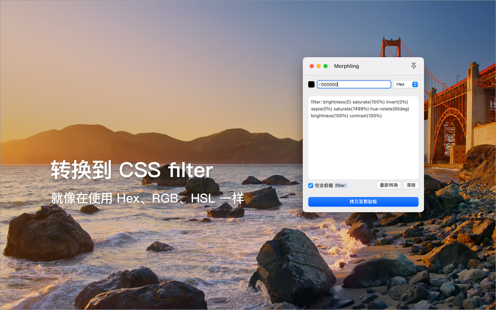

# Morphling

[English](./README.md) | 简体中文

起因是，在前端项目中更改单色 svg 图标的颜色，不同开发商的图标包，在添加 CSS 属性 `fill` 或者 `color` 后，可能不会按照预期得到想要的颜色，但是使用 CSS 的 `filter` 属性则可以强制修改。

得感谢 [CSS Filter Converter](https://github.com/OvidijusParsiunas/css-filter-converter) 这个项目提供了 JavaScript 的算法实现。

我仅将他的 web 实现带到了 macOS 桌面，以原生 SwiftUI 的方式。

## ✨ 特性

- [x] 免费且开源
- [x] 通过 JavaScriptCore 使用 npm 包
- [x] 暗黑模式
- [x] 多语言

## 📦 分发方式

## 👍 致谢

### 项目依赖

- [color](https://github.com/Qix-/color)
- [CSS Filter Converter](https://github.com/OvidijusParsiunas/css-filter-converter)
- [3dicons](https://3dicons.co/)

### 本地化翻译

- 日本語 - [@kum4423](https://github.com/kum4423)

## 📜 许可证

MIT License - Copyright (c) 2023 SvenFE
